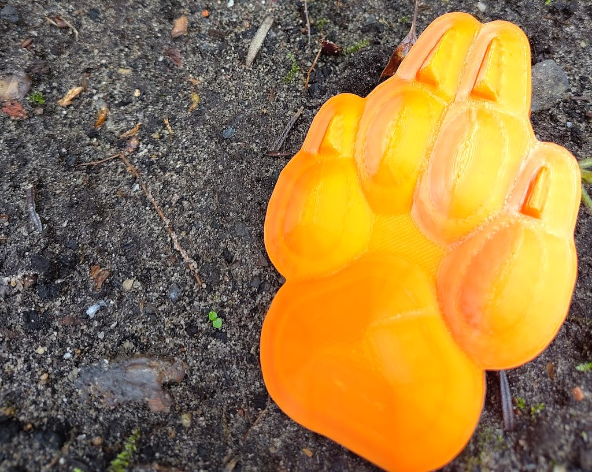
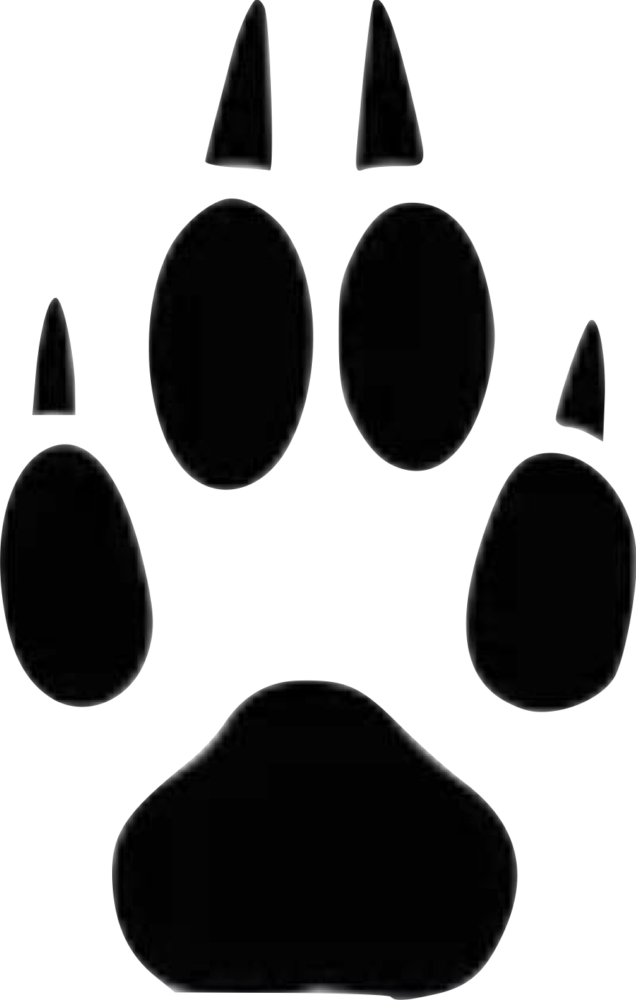
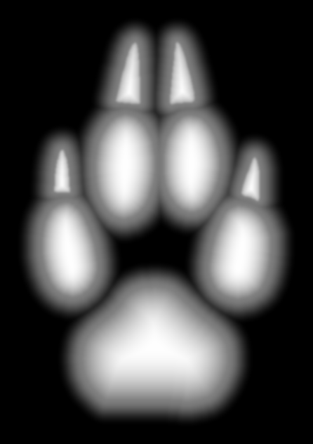
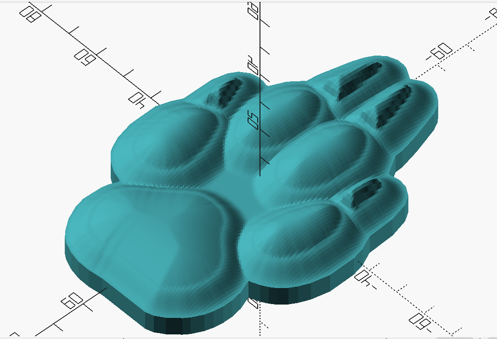
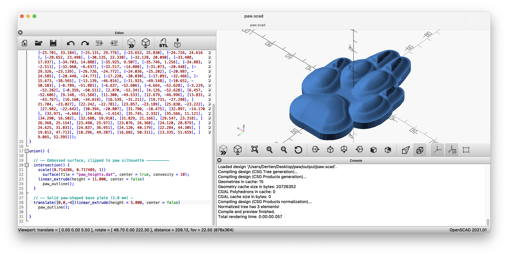

# footprint3d — SVG paw/footprint → 3-D printable stamp



Converts a 2-D SVG footprint (here a wolf paw, but any filled shapes work) into a
printable 3-D relief via a distance-field height map and OpenSCAD. The result is a
**paw-shaped stamp**: raised pads and claws on a base plate whose outline follows the
paw, ready for pressing into clay, sand or wax.

> Picking this project up again, or handing it to someone else?
> Read **[context.md](context.md)** — the technical hand-off: decisions, verified facts,
> known issues and next steps.

## Result at a glance

| 1. Input (SVG/PNG) | 2. Height map | 3. OpenSCAD model | 4. Printed |
|:---:|:---:|:---:|:---:|
|  |  |  |  |
| [`input/paw.svg`](input/paw.svg) | [`output/paw_heightmap.png`](output/paw_heightmap.png) · [`.svg`](output/paw_heightmap.svg) | [`output/paw.scad`](output/paw.scad) · [`paw.stl`](output/paw.stl) | print of the STL |

```
your_footprint.svg
      │
      ▼  footprint3d.py  (rasterise SVG → binary mask)
  binary mask
      │
      ▼  Euclidean Distance Transform  (scipy)
  height map  (per-region adaptive profile)
      │
      ├──▶  _heightmap.svg   coloured iso-contour visualisation
      ├──▶  _heightmap.png   greyscale preview
      ├──▶  .scad            OpenSCAD script (paw outline polygon embedded)
      └──▶  _heights.dat     height grid loaded by the .scad
```

---

## Contents

- [Project layout](#project-layout)
- [Setup](#setup)
- [Python environment quirks](#python-environment-quirks)
- [Quick start](#quick-start)
- [Parameters](#parameters)
- [How the height map works](#how-the-height-map-works)
- [From height map to STL in OpenSCAD](#from-height-map-to-stl-in-openscad)
- [SVG input requirements and limits](#svg-input-requirements-and-limits)
- [Output files](#output-files)
- [Test shapes](#test-shapes)
- [Known issues](#known-issues)
- [Scientific alternatives](#scientific-alternatives)

---

## Project layout

```
.
├── README.md                 this file
├── context.md                technical hand-off (decisions, verified facts, next steps)
├── footprint3d.py            the pipeline (SVG → height map → .scad + .dat)
├── make_test_shapes.py       generates synthetic test SVGs
├── input/
│   ├── paw.svg               the paw used throughout (9 subpaths: pad, 4 toes, 4 claws)
│   ├── paw.png               raster version of the same paw
│   └── wolfspootafdrukstempel1.pdf   original design brief (see below)
├── output/                   generated files for input/paw.svg  (see "Output files")
├── images/                   photos and screenshots used in this README
└── test_shapes/              synthetic SVGs for testing
```

**The design brief** — [`input/wolfspootafdrukstempel1.pdf`](input/wolfspootafdrukstempel1.pdf)
("2D-ontwerp voor 3D-wolfspootafdrukstempel met handvat", i.e. a 2-D design for a 3-D wolf-paw
print stamp *with handle*) specifies a paw of 7.59 × 10.75 cm and a print depth of about 3 cm in
sand, with a photo of a real wolf print for reference. The handle and the 3 cm depth are **not
implemented yet** — see [Known issues](#known-issues).

---

## Setup

### 1. Install OpenSCAD

Download from https://openscad.org/downloads.html. Developed and verified against
**OpenSCAD 2021.01**; used only for the final render step.

### 2. Install Python 3.11+

```bash
brew install python        # macOS with Homebrew
python3 --version
```

### 3. Create a virtual environment

**Always use a venv for this project** — see [Python environment quirks](#python-environment-quirks).

```bash
cd ~/Desktop/paw           # or wherever your project lives
python3 -m venv venv
source venv/bin/activate   # macOS / Linux
# venv\Scripts\activate    # Windows
```

Your prompt now shows `(venv)`. Activate it again in every new terminal.

### 4. Install Python dependencies

```bash
pip install svgpathtools svgwrite
pip install numpy scipy scikit-image Pillow
```

No system libraries and no Homebrew extras are required.

### 5. Verify

```bash
python -c "from svgpathtools import svg2paths2; import numpy, scipy, skimage, PIL; print('all ok')"
```

---

## Python environment quirks

### Why not just `pip install` globally?

On macOS, `pip install` without a venv installs into whichever Python owns the `pip`
command — often not the one you think. Four separate problems showed up here:

**Problem 1 — PlatformIO's Python.**
The first `pip install` went into PlatformIO's internal virtualenv
(`~/.platformio/penv/`), which is meant for PlatformIO's own use. Installing `cairosvg` there
needed to compile `pycairo`, which needs the Cairo C library (`libcairo`) on the OS. Without it
the build died with a long Meson error (`Pkg-config … not found`,
`Run-time dependency cairo found: NO`).

**Problem 2 — `cairosvg` imports but cannot run.**
Even where `cairosvg` installed, using it raised `OSError: no library called "cairo-2" was found`.
The Python package is only a wrapper; the native Cairo library must be installed separately.

**Problem 3 — `svglib` pulls in `rlpycairo` → `pycairo`.**
Switching to `svglib` hit the same Cairo wall one level deeper (`svglib → rlpycairo → pycairo`),
even inside a clean venv. Installing `svglib` with `--no-deps` got past pip, but rendering then
failed with `cannot import desired renderPM backend rlPyCairo`.

**Problem 4 — `svgpathtools --no-deps` misses `svgwrite`.**
`svgpathtools` imports `svgwrite` when the package loads, so a `--no-deps` install fails with
`ModuleNotFoundError: No module named 'svgwrite'`. Install it normally (`pip install svgpathtools svgwrite`).

**The final solution:** drop `cairosvg` and `svglib` entirely. The script parses SVG paths with
`svgpathtools` and rasterises them with `Pillow` — both pure Python. A clean venv keeps tool-managed
Pythons out of the picture.

**Rule of thumb:** if an error mentions `cairo`, `pycairo`, `Meson`, `pkg-config` or `libcairo`,
you have a system-library problem. Avoid the package that needs it rather than fighting the install.

(`brew install cairo` would also work, but couples your Python environment to a system library
that future Homebrew updates can break.)

### Reactivating the venv

```bash
cd ~/Desktop/paw
source venv/bin/activate
```

---

## Quick start

```bash
cd ~/Desktop/paw
source venv/bin/activate

# Reproduces the files in output/ exactly (verified byte-for-byte)
python footprint3d.py input/paw.svg --depth 8 --base 2 --width 80 --out output/

# Stamp variant: flat platform between the pads (see --stamp below)
python footprint3d.py input/paw.svg --depth 8 --base 3 --width 80 --stamp --out output/

# Render the STL from the command line …
openscad -o output/paw.stl output/paw.scad
# … or open the .scad in OpenSCAD, press F6, then F7 to export.
```

> **What `--width` means.** `--width` is the width of the whole *padded canvas*, not of the paw.
> With the defaults (`--res 512 --padding 60`) and `--width 80`, the paw contour itself is
> ≈ 58 × 92 mm and the finished stamp outline ≈ 72 × 105 mm. To hit a target size, scale
> `--width` accordingly and measure the polygon extents in the generated `.scad`.

---

## Parameters

### Core geometry

| Flag | Default | Description |
|------|---------|-------------|
| `--depth` | `8.0` | Emboss height in mm: how far the peaks rise above `base`. The SVG contour itself sits at `base + depth/2` |
| `--base` | `3.0` | Base plate thickness in mm (the height offset added to the whole height map) |
| `--width` | `80.0` | Physical width of the padded canvas in mm. Height follows the aspect ratio |
| `--res` | `512` | Rasterisation resolution in px (longest edge of the SVG content). Higher = more detail, slower |
| `--downsample` | `4` | Stride applied to the height grid before writing the `.dat`: `4` keeps every 4th pixel. Lower = finer grid, bigger file, slower OpenSCAD render |

### Height map profiles

Inside each shape, a normalised distance `t` runs from `0` at the contour to `1` at the centre of
*that shape*. It is turned into a height by one of two profiles:

| Flag | Default | Description |
|------|---------|-------------|
| `--pad-power` | `2.0` | Large shapes (pads): `1-(1-t)^p`. Steep rise at the contour, flat top — a pillbox. `p=1` linear, `p=2` steep sides + broad top, `p=3` near-vertical walls |
| `--nail-power` | `0.4` | Small shapes (claws): `t^p`. Values below 1 rise fast and end in a pointed tip |
| `--size-threshold` | `0.25` | A region whose inscribed-circle radius is below this fraction of the *largest* region's radius counts as a nail. Raise it if pads are misclassified |

```
Pad: 1-(1-t)^2  (steep sides, flat top)      Nail: t^0.4  (fast rise, pointed tip)
height                                        height
  1 ┤      ████████                              1 ┤  ▄█████████
    │    ██        ██                              │ █          █
    │  █              █                            │█            █
  0 ┤██                ██                        0 ┤              ██
    └──────────────────                            └──────────────────
    edge              centre                       edge            centre
```

### Bleed, smoothing and outline

| Flag | Default | Description |
|------|---------|-------------|
| `--blend` | `0.5` | Width of the outward slope beyond each contour, as a fraction of the largest shape's inscribed radius. It also sets how far the paw outline extends. `0.3` tight, `0.5` medium, `0.8` wide |
| `--smooth` | `1.5` | Gaussian blur (px) applied to the finished height map. Keep it small (1–3) |
| `--padding` | `60` | Blank pixels added around the SVG before computing distances, so the bleed is never clipped by the canvas edge. It is in pixels at `--res`: scale it if you change `--res` |
| `--simplify` | `1.0` | Tolerance (px) for simplifying the outline polygon embedded in the `.scad`. Higher = fewer points |

### Stamp mode

| Flag | Default | Description |
|------|---------|-------------|
| `--stamp` | off | The outward bleed slopes down to a flat platform instead of to the base plate, and output files get a `_stamp` suffix. **The paw-shaped outline is used with or without this flag** |
| `--stamp-level` | `0.15` | Platform height as a fraction of `--depth`: the platform sits at `base + stamp-level × depth`. Because the outline cuts the platform off, it leaves a vertical wall of that height at the stamp's edge |

### Visualisation and output

| Flag | Default | Description |
|------|---------|-------------|
| `--levels` | `12` | Number of colour bands in `_heightmap.svg` |
| `--out` | folder of the SVG | Output directory |

---

## How the height map works

Each pixel of the rasterised mask gets its distance to the nearest contour edge (Euclidean
Distance Transform). Every iso-distance line is a smaller, eroded copy of the original shape, so
a kidney-shaped pad stays kidney-shaped all the way up to its peak. That distance is normalised
per region and passed through a profile function:


*White = high, black = base level. Pads form flat-topped pillows; claws taper to a ridge.
[Colour-banded SVG version](output/paw_heightmap.svg).*

```
  height
    │
  1 ┤              ████████   ← flat top (pad profile, p=2)
    │          ████        ████
    │       ███                ███
0.5 ┤───████                        ████───  ← SVG contour line
    │  ██                                ██
    │ █                                    █
  0 ┤█                                      █
    └─────────────────────────────────────────
    far outside    contour    centre    contour    far outside
```

The outward bleed (from the contour down to the floor) always uses a cosine ease, whatever the
inward profile. In `--stamp` mode the floor is the stamp platform instead of zero.

---

## From height map to STL in OpenSCAD

The generated `.scad` combines the rectangular `surface()` height grid with the paw outline:

```openscad
union() {
  intersection() {                       // relief, clipped to the paw outline
    scale([px_x, px_y, 1])
      surface(file = "paw_heights.dat", center = true, convexity = 10);
    linear_extrude(height = total_h) paw_outline();
  }
  linear_extrude(height = base) paw_outline();   // solid paw-shaped base plate
}
```

`paw_outline()` is a `polygon()` embedded in the `.scad` — no external SVG is imported (see
[why](#why-svg-import-in-openscad-was-abandoned)).



*OpenSCAD 2021.01 with the generated `paw.scad`. Note the base plate line here
(`translate([0,0,-4]) linear_extrude(height = 5)`) was hand-edited to thicken the base; the
generator itself writes `linear_extrude(height = base)`.*


*The rendered model. The pale pit near the base of each claw is a known artefact — see
[Known issues](#known-issues).*

Render and export: open the `.scad`, press **F6** (full render, ~30–60 s), then **F7**
(export STL) — or use the `openscad -o` command from the quick start. The result for the paw is
[`output/paw.stl`](output/paw.stl).

---

## SVG input requirements and limits

The script reads [`input/paw.svg`](input/paw.svg) (raster twin: [`input/paw.png`](input/paw.png)):


### What works

- Filled `<path>` elements with M, L, C, S, Q, A commands (lines, béziers, arcs)
- Compound paths: many `M…Z` subpaths inside one `<path>` (as in `paw.svg`: 9 subpaths in one path)
- `<g>` transforms `translate()` and `scale()`, including nested groups
- Black fill on white or transparent background; Inkscape Trace Bitmap output (Plain SVG)

### What will fail or give wrong results

| Issue | Symptom | Fix |
|-------|---------|-----|
| `<circle>`, `<ellipse>`, `<rect>`, `<polygon>` | Shape missing, empty mask | Inkscape: select all → **Path → Object to Path**, save as Plain SVG |
| Stroke-only paths (no fill) | Empty mask | Give every shape a black fill |
| `rotate()`, `matrix()`, `skewX/Y()` transforms | Shape misaligned | Inkscape: **Object → Flatten Transforms** |
| `<use>`, `<symbol>`, `<defs>` references | Shapes missing | Unlink clones/symbols before export |
| Details under ~2 px at `--res 512` | Detail lost | Use `--res 1024` (and scale `--padding`) |
| Semi-transparent fills | Shape partly missing | Make fills fully opaque black |
| No `width`/`height` on `<svg>` (only `viewBox`) | Wrong aspect/size | Add `width` and `height` |
| Shapes that **touch or overlap** | Treated as one region: no separate pad/nail profiles | Keep a visible gap between shapes (see [Test shapes](#test-shapes)) |

### Inkscape preparation checklist

1. Open the SVG in Inkscape and select all (`Ctrl+A`)
2. **Path → Object to Path**
3. **Object → Flatten Transforms** if any group is rotated
4. Black fill on every shape
5. **File → Save a Copy → Plain SVG** (not Inkscape SVG)

### Why SVG import in OpenSCAD was abandoned

An early version wrote the paw outline to a separate SVG and loaded it with `import()`. Centering
kept failing because of three compounding ambiguities in OpenSCAD 2021's SVG import: the **Y-axis
flip** (SVG down vs. OpenSCAD up), the **viewBox origin** (the bottom-left corner of the viewBox
becomes the origin, so a centred viewBox lands offset) and **units** (`mm`/`px`/unitless interpreted
inconsistently). The outline is now computed in Python in the same coordinate system as
`surface(center=true)` and embedded as a `polygon()`. `output/paw_outline.svg` is a leftover of
the old approach and is no longer used.

---

## Output files

Generated by `python footprint3d.py input/paw.svg --depth 8 --base 2 --width 80 --out output/`:

| File | What it is |
|------|------------|
| [`output/paw.scad`](output/paw.scad) | OpenSCAD script with the embedded outline polygon — open this |
| [`output/paw_heights.dat`](output/paw_heights.dat) | Height grid in mm, read by the `.scad` (keep both files in one folder) |
| [`output/paw.stl`](output/paw.stl) | The exported mesh (from the `.scad` with the hand-edited base, see above) |
| [`output/paw_heightmap.png`](output/paw_heightmap.png) | Greyscale height map (white = high) |
| [`output/paw_heightmap.svg`](output/paw_heightmap.svg) | Colour-banded height map (blue = low, red = peak); large file, open in a browser |
| [`output/paw_outline.svg`](output/paw_outline.svg) | **Stale** — from the abandoned SVG-import approach, safe to delete |

With `--stamp`, names become `paw_stamp.scad`, `paw_stamp_heights.dat`, `paw_stamp_heightmap.*`.

---

## Test shapes

`python make_test_shapes.py` writes four synthetic SVGs to `test_shapes/`:

| File | Description | Good for |
|------|-------------|----------|
| [`toes.svg`](test_shapes/toes.svg) | Circle body + 3 round toes (this is `shape_circle_3toes.svg` under a shorter name) | Basic pipeline check |
| [`shape_ellipse_5toes.svg`](test_shapes/shape_ellipse_5toes.svg) | Ellipse body + 5 oval toes + heel | Aspect ratio, several regions |
| [`shape_heel_block.svg`](test_shapes/shape_heel_block.svg) | Rounded rectangle | Profile symmetry |
| [`shape_paw_4toes.svg`](test_shapes/shape_paw_4toes.svg) | 4-toe paw of ellipses | Overlapping-shape behaviour |

All four run cleanly with the current script. Note that in `toes.svg` and `shape_paw_4toes.svg` the
toes *overlap* the body, so each paw is one connected region and gets a single profile; use
[`input/paw.svg`](input/paw.svg) to see the pad/nail distinction.

```bash
python footprint3d.py test_shapes/shape_ellipse_5toes.svg --depth 8 --base 3 --width 80 --out output/
```

---

## Known issues

Details and ideas are in [context.md](context.md#9-known-issues-open-questions-and-next-steps).

- **Claw pits.** Each claw shows a dark pit/step near its base in the OpenSCAD preview and a
  matching notch in the [print](images/footprint.jpg). Cause not yet diagnosed.
- **Mirrored top view.** Image row 0 maps to −Y, so the model seen from above is a vertical mirror of
  the SVG. For a stamp pressed into clay the impression reads like the original; to make the model
  itself read like the SVG, mirror it.
- **`--width` is the canvas width**, not the paw width (see Quick start).
- **Handle and 3 cm depth** from the design brief are not implemented.
- **Touching shapes merge** into a single region.

---

## Scientific alternatives

This script uses a morphological distance-field approach: practical for SVG-to-print with no
measurement hardware. For higher accuracy:

**Pressure plate / pedobarograph** — measure contact pressure on a grid sensor, normalise to height
and feed it straight to `surface()`, skipping the distance transform. Biomechanically accurate;
needs hardware.

**Photogrammetry** — 40–50 photos processed with Meshroom (free, GPU) or COLMAP give a full mesh;
no SVG pipeline needed.

**Statistical shape model (PCA)** — fit a 2-D silhouette to a PCA model trained on thousands of 3-D
scans (e.g. CAESAR). Used in orthotics CAD; needs a large scan database and ICP registration.

**Depth-from-shading** — one photo under raking light encodes surface normals; Horn's algorithm
(implementable in numpy) recovers approximate depth. Photo-only, but needs careful lighting.
